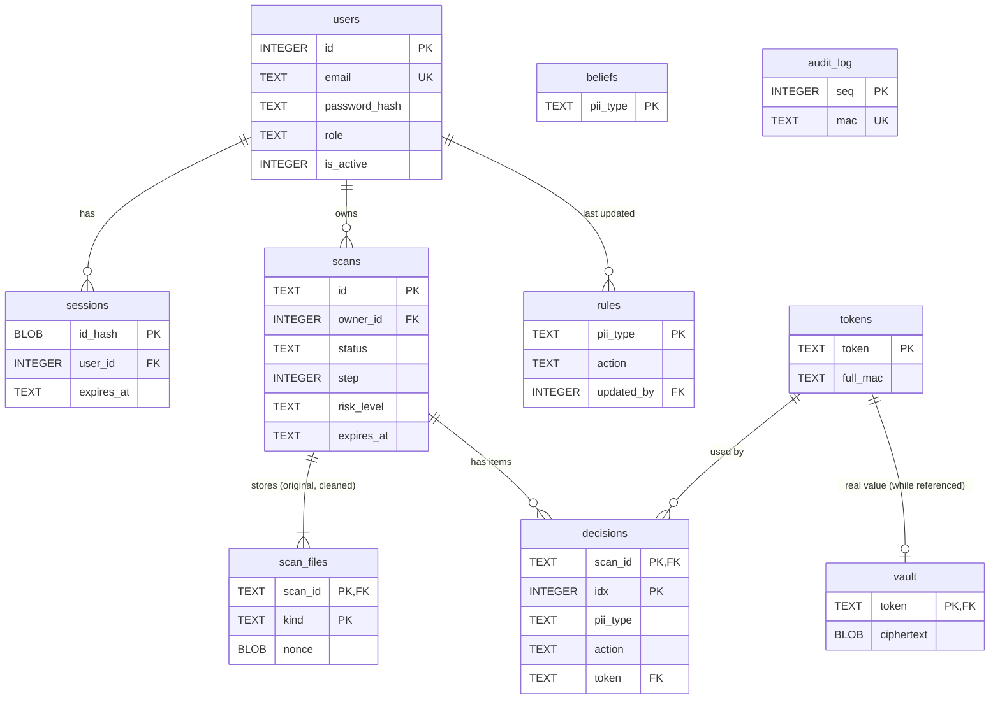

# DATABASE: Privacy Guardian Agent v2

> The complete data model. Sources of truth: **PRD.md** (journeys, data requirements, D1 to D12) and **ARCHITECTURE.md** (stack, flows, security). This file **refines ARCHITECTURE.md section 7**; where they differ, this file wins for anything about data.
>
> Uses ARCHITECTURE.md decisions **D14** (server-side sessions), **D15** (a 4th key, `PG_STORAGE_KEY`) and **D17** (one worker thread), approved in ADR-0022.

---

## 1. Technology

| Item | Choice | Why |
| --- | --- | --- |
| Engine | **SQLite 3** (≥ 3.37), one file `app.db` | D2: one user at a time, no server to run, one file to back up |
| Table mode | `STRICT` tables | SQLite normally accepts any value in any column; `STRICT` enforces the declared types |
| Journal | WAL | The API reads while the worker writes, without blocking |
| Connection settings | `foreign_keys=ON`, `busy_timeout=5000`, `synchronous=NORMAL` | Foreign keys are off by default in SQLite; set on every connection |
| Access | SQLAlchemy 2.x Core/ORM, only from `app/storage/` | ARCHITECTURE 3.1 |
| Migrations | Alembic, batch mode for SQLite | Section 9 |
| Graph checkpoints | Separate file `checkpoints.db`, schema owned by `langgraph-checkpoint-sqlite` | Not part of this model; covered in section 7.4 |
| Files | Encrypted blobs in `DATA_DIR/files/`, metadata in `scan_files` | Large binary data stays out of the database |

### 1.1 Type conventions

| Logical type | SQLite `STRICT` type | Format |
| --- | --- | --- |
| Internal id | `INTEGER` | Row id, never shown in URLs |
| Public id | `TEXT` | UUID v4, lowercase, 36 chars (scans only) |
| Timestamp | `TEXT` | UTC ISO 8601 with milliseconds and `Z`, e.g. `2026-11-19T00:58:12.345Z` (sorts correctly as text) |
| Boolean | `INTEGER` | `0` or `1`, with a `CHECK` |
| Enum | `TEXT` | Closed list enforced with `CHECK (col IN (...))` |
| Hash / MAC | `TEXT` | Lowercase hex, fixed length, `CHECK (length(col) = 64)` |
| Binary | `BLOB` | Nonces, ciphertext, session hashes |
| JSON | `TEXT` | `CHECK (json_valid(col))` |

### 1.2 Shared enums

| Name | Values |
| --- | --- |
| `pii_type` | `EMAIL, PHONE, AADHAAR, PAN, IFSC, CARD, IP_ADDRESS, GOV_ID, PERSON, LOCATION, ADDRESS, ORG, DATE, AGE, GENDER` |
| `action` | `keep, generalize, mask, pseudonymize, redact` |
| `scan_status` | `queued, running, needs_review, done, failed` |
| `risk_level` | `LOW, MEDIUM, HIGH, DIRECT` |
| `role` | `user, admin` |

These match the Python enums in `app/detectors/types.py`, `app/policy/actions.py` and `app/fusion/risk.py`. A test fails if the two lists drift apart.

---

## 2. Entity overview

**10 tables.** Each maps to a PRD data item; nothing is stored twice.

| Table | Holds | PRD source |
| --- | --- | --- |
| `users` | Accounts and roles | Roles (PRD 9) |
| `sessions` | Logged-in sessions | FR-32, D14 |
| `scans` | One row per scan: status, progress, risk | J1, J2, US-4, US-6, US-11 |
| `scan_files` | Encrypted original and cleaned files | US-3, FR-30, D4 |
| `decisions` | One row per found item: where, what, which action, why | US-2, FR-18 |
| `tokens` | HMAC token registry for collision checks (no values) | FR-24 |
| `vault` | Encrypted real value behind a token | J3, FR-25, D8 |
| `rules` | Admin fixed action per PII type | J5, FR-20 |
| `beliefs` | Learned sensitivity and precision per PII type | FR-15 to FR-17 |
| `audit_log` | Tamper-evident event chain | J4, FR-26, FR-27 |

`audit_log` has no foreign keys by design (section 3.10).

### 2.1 Deliberately not stored

| Not a table | Why |
| --- | --- |
| Review items for a paused scan | Already in the graph checkpoint (ARCHITECTURE 5.2); copying them would duplicate raw text |
| JSON report file | Built on download from `scans` + `decisions`; never stale, never duplicated |
| Original document text | Read from the encrypted original file when the owner opens S4 |
| Scan queue, login rate limits | In memory (ARCHITECTURE 3.3, 8.1); lost on restart by design; the queue is rebuilt from `scans.status` |
| Organisations | One per deployment (D3) |
| Audit anchor | A separate file (D10), deliberately outside the database it protects |
| Belief priors | Constants in code; a missing `beliefs` row means "use the prior", so no seed rows are needed |

---

## 3. Tables

### 3.1 `users`

| Column | Type | Null | Default | Constraint / note |
| --- | --- | --- | --- | --- |
| `id` | INTEGER | no | auto | **PK** |
| `email` | TEXT | no | | **UNIQUE**, `COLLATE NOCASE`, `CHECK (length(email) BETWEEN 3 AND 254 AND instr(email,'@') > 1)` |
| `password_hash` | TEXT | no | | bcrypt string, `CHECK (length(password_hash) = 60)` |
| `role` | TEXT | no | `'user'` | `CHECK (role IN ('user','admin'))` |
| `is_active` | INTEGER | no | `1` | `CHECK (is_active IN (0,1))`. Accounts are disabled, never deleted, because audit records refer to them |
| `created_at` | TEXT | no | now | |

### 3.2 `sessions`

| Column | Type | Null | Constraint / note |
| --- | --- | --- | --- |
| `id_hash` | BLOB | no | **PK**. SHA-256 of the cookie value, `CHECK (length(id_hash) = 32)`. The cookie value itself is never stored |
| `user_id` | INTEGER | no | **FK → users.id `ON DELETE CASCADE`** |
| `created_at` | TEXT | no | |
| `last_seen_at` | TEXT | no | Updated at most once a minute, to avoid a write on every request |
| `expires_at` | TEXT | no | `MIN(created_at + 7 days, last_seen_at + 8 hours)`, recomputed on touch |

### 3.3 `scans`

| Column | Type | Null | Default | Constraint / note |
| --- | --- | --- | --- | --- |
| `id` | TEXT | no | | **PK**, UUID v4, `CHECK (length(id) = 36)` |
| `owner_id` | INTEGER | no | | **FK → users.id `ON DELETE RESTRICT`** |
| `filename` | TEXT | no | | Original name, `CHECK (length(filename) BETWEEN 1 AND 255)`. Pasted text: `pasted-text.txt`. **May contain personal data** (section 7) |
| `format` | TEXT | no | | `CHECK (format IN ('txt','md','pdf','docx','csv'))` |
| `status` | TEXT | no | `'queued'` | `CHECK (status IN ('queued','running','needs_review','done','failed'))` |
| `step` | INTEGER | no | `0` | Progress step 0 to 5 (DESIGN 5.7), `CHECK (step BETWEEN 0 AND 5)` |
| `round` | INTEGER | no | `1` | Verifier round, `CHECK (round BETWEEN 1 AND 3)` |
| `risk_level` | TEXT | yes | | `CHECK (risk_level IN ('LOW','MEDIUM','HIGH','DIRECT'))` |
| `est_matches` | REAL | yes | | Estimated people matching the clues, `CHECK (est_matches >= 0)` |
| `risk_clues` | TEXT | yes | | JSON array of clue names, e.g. `["gender","age_range"]`, `CHECK (json_valid(risk_clues))` |
| `unresolved_leaks` | INTEGER | no | `0` | `CHECK (unresolved_leaks >= 0)` |
| `model_version` | TEXT | yes | | First 12 hex of the weights' SHA-256 |
| `error_code` | TEXT | yes | | From ARCHITECTURE 13.2 |
| `created_at` | TEXT | no | now | |
| `updated_at` | TEXT | no | now | Changed on every status or step update (polling reads it) |
| `finished_at` | TEXT | yes | | Set on `done` or `failed` |
| `expires_at` | TEXT | no | | `created_at + RETENTION_DAYS` (D8) |

Table-level checks (state consistency):
- `CHECK (status <> 'done' OR (risk_level IS NOT NULL AND est_matches IS NOT NULL AND risk_clues IS NOT NULL AND finished_at IS NOT NULL))`
- `CHECK (status <> 'failed' OR (error_code IS NOT NULL AND finished_at IS NOT NULL))`
- `CHECK (status NOT IN ('queued','running','needs_review') OR finished_at IS NULL)`
- `CHECK (expires_at > created_at)`

### 3.4 `scan_files`

| Column | Type | Null | Constraint / note |
| --- | --- | --- | --- |
| `scan_id` | TEXT | no | **FK → scans.id `ON DELETE CASCADE`** |
| `kind` | TEXT | no | `CHECK (kind IN ('original','cleaned'))` |
| `content_type` | TEXT | no | MIME type sent on download |
| `size_bytes` | INTEGER | no | Plaintext size, `CHECK (size_bytes BETWEEN 0 AND 10485760)` |
| `key_id` | TEXT | no | Which `PG_STORAGE_KEY` encrypted it (rotation, FR-29) |
| `nonce` | BLOB | no | AES-GCM nonce, `CHECK (length(nonce) = 12)` |
| `created_at` | TEXT | no | |

- **PK** (`scan_id`, `kind`).
- The file path is **derived**, not stored: `files/{scan_id}.{kind}`. Associated data for AES-GCM is `scan_id|kind|key_id`, so a file copied onto another scan fails to decrypt.
- Deleting a row and deleting its file happen in the same service call; the retention job also removes any file with no row (section 10.3).

### 3.5 `decisions`

| Column | Type | Null | Constraint / note |
| --- | --- | --- | --- |
| `scan_id` | TEXT | no | **FK → scans.id `ON DELETE CASCADE`** |
| `idx` | INTEGER | no | Item number in reading order, `CHECK (idx >= 0)` |
| `round` | INTEGER | no | Round that found it, `CHECK (round BETWEEN 1 AND 3)` |
| `start_offset` | INTEGER | no | Character offset in the parsed text, `CHECK (start_offset >= 0)` |
| `end_offset` | INTEGER | no | Exclusive, `CHECK (end_offset > start_offset)` |
| `pii_type` | TEXT | no | `CHECK (pii_type IN (…pii_type…))` |
| `score` | REAL | no | `CHECK (score BETWEEN 0 AND 1)` |
| `sources` | TEXT | no | `+`-joined detector names, e.g. `ner+rules`, `CHECK (sources GLOB '[a-z]*')` |
| `action` | TEXT | no | `CHECK (action IN ('keep','generalize','mask','pseudonymize','redact'))` |
| `reason` | TEXT | no | `CHECK (reason IN ('utility','override','review','risk','business number'))` |
| `token` | TEXT | yes | **FK → tokens.token `ON DELETE RESTRICT`**. Set for every item that belongs to an entity; used in the output only when `action = 'pseudonymize'` |

- **PK** (`scan_id`, `idx`).
- `CHECK (action <> 'pseudonymize' OR token IS NOT NULL)`.
- **No value column.** The item's text is a slice of the encrypted original; the report shows offsets, types, actions and tokens only.
- Round 2 and 3 items are offsets into that round's text. `round` tells the renderer which text they belong to; the round texts are rebuilt by applying earlier rounds' decisions to the original.

### 3.6 `tokens`

| Column | Type | Null | Constraint / note |
| --- | --- | --- | --- |
| `token` | TEXT | no | **PK**, e.g. `PERSON_c97ab2`, `CHECK (token GLOB '[A-Z]*_[0-9a-f]*' AND length(token) BETWEEN 8 AND 80)` |
| `full_mac` | TEXT | no | Full HMAC-SHA256 hex, `CHECK (length(full_mac) = 64)`. Identifies the value without revealing it |
| `key_id` | TEXT | no | `PG_TOKEN_KEY` id used |
| `created_at` | TEXT | no | |

- Kept permanently: it holds no values, and dropping it would let a later value take an old token (ADR-0020 collision rule).
- `UNIQUE (full_mac, key_id)`: one value under one key has exactly one token.

### 3.7 `vault`

| Column | Type | Null | Constraint / note |
| --- | --- | --- | --- |
| `token` | TEXT | no | **PK**, **FK → tokens.token `ON DELETE RESTRICT`** |
| `pii_type` | TEXT | no | `CHECK (pii_type IN (…))`; part of the AES-GCM associated data |
| `key_id` | TEXT | no | `PG_VAULT_KEY` id used |
| `nonce` | BLOB | no | `CHECK (length(nonce) = 12)` |
| `ciphertext` | BLOB | no | AES-256-GCM of the canonical value; associated data = `token|pii_type|key_id` |
| `created_at` | TEXT | no | |

**Lifetime (D8):** one token can appear in several scans (the same person in two documents), so a vault row is not tied to one scan. It is deleted when **no remaining `decisions` row uses its token** (section 10.3). This meets D8 ("deleted with the document") without duplicating rows per scan.

### 3.8 `rules`

| Column | Type | Null | Constraint / note |
| --- | --- | --- | --- |
| `pii_type` | TEXT | no | **PK**, `CHECK (pii_type IN (…))` |
| `action` | TEXT | no | `CHECK (action IN (…action…))`. Whether the action makes sense for the type is checked by the service (the domain's `allowed()`), not duplicated in SQL |
| `updated_by` | INTEGER | no | **FK → users.id `ON DELETE RESTRICT`** |
| `updated_at` | TEXT | no | |

No row = "Automatic" (DESIGN 7).

### 3.9 `beliefs`

| Column | Type | Null | Constraint / note |
| --- | --- | --- | --- |
| `pii_type` | TEXT | no | **PK**, `CHECK (pii_type IN (…))` |
| `sens_alpha`, `sens_beta` | REAL | no | Sensitivity Beta, `CHECK (sens_alpha > 0 AND sens_beta > 0)` |
| `prec_alpha`, `prec_beta` | REAL | no | Precision Beta, `CHECK (prec_alpha > 0 AND prec_beta > 0)` |
| `updated_at` | TEXT | no | |

No row = prior from code. "Reset learning" deletes rows.

### 3.10 `audit_log`

| Column | Type | Null | Constraint / note |
| --- | --- | --- | --- |
| `seq` | INTEGER | no | **PK**, starts at 0, gap-free, `CHECK (seq >= 0)`. Assigned by the app, not `AUTOINCREMENT` |
| `ts` | TEXT | no | |
| `actor` | TEXT | no | `user:{id}` or `system`, `CHECK (actor = 'system' OR actor GLOB 'user:[0-9]*')` |
| `event` | TEXT | no | `CHECK (event IN ('scan_completed','review','reidentify','reidentify_denied','rules_changed','beliefs_reset','retention','user_created','user_disabled','anchor_saved'))` |
| `payload` | TEXT | no | `CHECK (json_valid(payload))`. Never raw values (section 7) |
| `payload_hash` | TEXT | no | `CHECK (length(payload_hash) = 64)` |
| `prev_mac` | TEXT | no | `CHECK (length(prev_mac) = 64)` |
| `kid` | TEXT | no | `PG_AUDIT_KEY` id |
| `mac` | TEXT | no | **UNIQUE**, `CHECK (length(mac) = 64)` |

- **No foreign keys on purpose.** The chain must stay verifiable forever, even after scans expire. `actor` holds a user id as text; the UI joins it to `users` for display, and accounts are never deleted (3.1).
- **Append-only:** triggers `audit_no_update` and `audit_no_delete` raise an error on any UPDATE or DELETE. The MAC chain detects edits made outside SQLite; the triggers stop accidental edits through it.
- **Write order:** the next `seq` and `prev_mac` are read and the new row is inserted **in one transaction** (`BEGIN IMMEDIATE`), so two writers can never fork the chain.

---

## 4. Relationships and ER diagram

| Relationship | Cardinality | On delete of parent |
| --- | --- | --- |
| users → sessions | 1 : many | CASCADE (sessions go with the user) |
| users → scans | 1 : many | RESTRICT (users are disabled, not deleted) |
| users → rules | 1 : many | RESTRICT |
| scans → scan_files | 1 : 1–2 | CASCADE |
| scans → decisions | 1 : many | CASCADE |
| tokens → decisions | 1 : many | RESTRICT (registry is permanent) |
| tokens → vault | 1 : 0–1 | RESTRICT |
| `audit_log` | none | Independent by design |

---

## 5. Constraints and validation

Validation happens in three places; each catches a different mistake.

| Layer | Checks | Example |
| --- | --- | --- |
| API schemas (Pydantic) | Shape, length, format of input; gives the user-facing error | "Reason must be at least 10 characters." |
| Services / domain | Business rules across rows | Answers only while `needs_review`; action allowed for the type; owner matches |
| Database | Invariants that must never break, even through a bug | Enum `CHECK`s, `STRICT` types, state checks on `scans`, foreign keys, append-only triggers, unique MACs |

Rules the database alone guarantees:
1. No value outside an enum, no wrong type (STRICT).
2. A `done` scan always has its risk result; a `failed` scan always has an error code.
3. A pseudonymized item always has a token, and that token exists in the registry.
4. No vault row without a registered token.
5. No audit row is ever changed or removed through SQL.
6. No two sessions share a hash; no two users share an email (case-insensitive).

---

## 6. Indexes (from real queries)

Primary keys and `UNIQUE` constraints already index: user by email (login), session by hash (every request), scan by id, decisions by scan in item order, token and vault by token (reveal), beliefs and rules by type, audit by `seq` (newest first paging, verify in order).

Extra indexes, only where a real query needs one:

| Index | Query it serves | Where |
| --- | --- | --- |
| `scans_owner_created` on `scans(owner_id, created_at DESC)` | My scans, newest first (S2, US-11) | Every visit to S2 |
| `scans_expires` on `scans(expires_at)` | Retention: scans past `expires_at` | Daily job |
| `sessions_expires` on `sessions(expires_at)` | Delete expired sessions | Daily job |
| `sessions_user` on `sessions(user_id)` | Log out everywhere when an account is disabled; cascade | Rare, but avoids a full scan per user |
| `decisions_token` on `decisions(token) WHERE token IS NOT NULL` | Vault cleanup: does any decision still use this token? | Daily job |

Not indexed, on purpose: `scans.status` (only read once at startup to rebuild the queue; a small table scan), `audit_log.event` (no screen filters by event in MVP). Add them when a real query needs them.

---

## 7. Sensitive data handling

### 7.1 Classification

| Class | Meaning | Columns / files |
| --- | --- | --- |
| **Secret** | Never stored in the database | The 4 keys, plain passwords, session cookie values |
| **Raw personal data, encrypted** | The real data of the people in the documents | `vault.ciphertext`; `files/*` (original, cleaned); `checkpoints.db` contents |
| **Possibly personal** | May contain a name by accident | `scans.filename` (e.g. `resume_rahul.pdf`) |
| **Staff data** | Data about the tool's own users | `users.email`, `audit_log.actor` (as an id) |
| **Pseudonymous** | Cannot be turned into a value without a key | `tokens.*`, `decisions.token` |
| **Operational** | No personal data | Everything else |

### 7.2 Rules

| Rule | How |
| --- | --- |
| Raw values never in plaintext columns | No table has a "value" column except `vault.ciphertext` |
| Encrypted with separate keys | Files and checkpoints: `PG_STORAGE_KEY` (D15). Vault: `PG_VAULT_KEY`. Tokens: `PG_TOKEN_KEY`. Audit: `PG_AUDIT_KEY` |
| Ciphertext bound to its row | AES-GCM associated data includes the row's identity (3.4, 3.7), so swapping rows breaks decryption |
| Filenames never leave the scan | `scans.filename` is shown only to the owner, deleted with the scan, and **never written to `audit_log`** (the audit log is permanent). Audit payloads refer to scans by id |
| Audit payloads | Only ids, types, actions, counts, verdicts, tokens and reasons typed by admins. A test fails if a sample value or filename appears in any payload |
| Staff emails | Needed for login; never in audit payloads (actor is `user:{id}`) |
| Deletion is real | Rows are deleted, not flagged; files are removed; SQLite runs `PRAGMA secure_delete=ON` so freed pages are zeroed |
| Retention | Scans, files, decisions: `RETENTION_DAYS` (7). Vault rows: when no decision references them. Checkpoints: when the scan ends, at most 1 day after. Sessions: on expiry. `tokens`, `beliefs`, `rules`, `users`, `audit_log`: kept |
| Admin reads | Admins see `audit_log` and can reveal a token with a reason; no admin query returns another user's file or filename |

> **Correction to DESIGN.md S6:** its example audit row shows `patient_note.txt`. Under rule "Filenames never leave the scan" the audit details show a short scan id instead (e.g. `scan 3f2a9c1e, low risk`).

---

## 8. Ownership, authorization and row-level security

SQLite has **no built-in row-level security**. The same effect is enforced in one place, the storage layer, and tested.

| Data | Who can read | Who can write | Enforcement |
| --- | --- | --- | --- |
| `users` | Self (own row); admin (list, for audit display) | Admin (create, disable); self (password, later) | Service checks role |
| `sessions` | Nobody through the API | Auth service only | Not exposed |
| `scans`, `scan_files`, `decisions` | **Owner only** | Owner (create, answer, delete); worker (progress, results); retention job (delete) | Every repository method for these tables takes `owner_id` and adds `WHERE owner_id = :owner_id`; there is no method that reads a scan without it, except the worker's and retention's, which live in a separate module the API cannot import |
| `tokens` | Nobody through the API | Pseudonymizer | Not exposed |
| `vault` | Admin, one token at a time, with a reason | Pseudonymizer (insert), retention (delete) | `Vault.reidentify` checks role and reason; every call is audited |
| `rules` | Admin | Admin | Role dependency |
| `beliefs` | Nobody directly (used by the policy) | Review answers; admin reset | Not exposed except reset |
| `audit_log` | Admin | Append only, by services | Role dependency + triggers |

**Tests:** an authorization matrix runs every scan endpoint as the owner, another user and an admin; anything but the owner must get 404. A static check fails the build if an API module imports the unscoped worker repository.

**Future (Postgres):** the same rule becomes an RLS policy on `scans`, `scan_files` and `decisions` (`owner_id = current_setting('app.user_id')`), with the worker using a separate role that bypasses it.

---

## 9. Migrations and seeds

### 9.1 Migrations

| Rule | Detail |
| --- | --- |
| Tool | Alembic, `render_as_batch=True` (SQLite rebuilds a table to change it) |
| Baseline | Revision `0001_initial` creates all 10 tables, checks, indexes and triggers. No earlier database exists, so there is nothing to migrate from |
| One change per revision | Named `NNNN_short_description`; schema and data changes in separate revisions |
| When they run | At container start, `alembic upgrade head` runs before the app accepts requests; if it fails, the app does not start |
| Before upgrading | The start script makes an online backup of `app.db` (section 10) |
| Downgrades | Written for every revision and tested in CI, but **production only moves forward**; a bad release is fixed by restoring the pre-upgrade backup or by a new forward revision |
| CI | Upgrade an empty database to head; downgrade to base; upgrade again; then run all storage and API tests on it |
| Enum changes | Adding a PII type or event is a migration that rebuilds the table's `CHECK` (batch mode) plus a code change in the same pull request; a test compares SQL enums with Python enums |
| Checkpoints | `checkpoints.db` is created and upgraded by the LangGraph saver itself; it holds only short-lived data, so a breaking library change can simply start a new file once no scan is open |

### 9.2 Seeds

| Seed | How | When |
| --- | --- | --- |
| First admin | `python -m app.cli create-user --email … --role admin` (asks for the password), or `ADMIN_EMAIL`/`ADMIN_PASSWORD` used once at start if `users` is empty; writes `user_created` to the audit log | First deployment |
| Beliefs, rules | **None.** Missing rows mean prior / automatic | Never |
| Demo data | `python -m app.cli seed-demo` creates a `demo` user and runs the files in `data/samples/` through the **normal scan pipeline** (no hand-written rows, so the audit chain stays valid) | Only for a demo host that resets (D13 option c) |
| Tests | Factories create rows per test in a temporary database; no shared fixtures file | Every test run |

---

## 10. Backup and recovery

### 10.1 What to back up

| Item | Needed? | Note |
| --- | --- | --- |
| `app.db` | Yes | Use SQLite's online backup (consistent while running), never a plain file copy of a WAL database |
| `files/` | Yes | Encrypted already |
| `audit.anchor.json` | Yes, **stored somewhere else** than the database backups (D10) | Otherwise a restored, tampered backup could also restore a matching anchor |
| `checkpoints.db` | No | Only open scans; after a restore they are marked `failed` with `error_code = 'restored'` and can be re-run |
| Keys | **Never in the same place as backups** | Kept in the host's secret store and a password manager. Backups without keys cannot be read; keys without backups cannot restore data |

### 10.2 Schedule and targets

- **Daily** online backup of `app.db` + `files/` to a second location, plus one before every migration.
- **Keep 7 days of backups.** Backups must not outlive retention by much: with 7-day retention and 7-day backup rotation, deleted documents are gone from every copy within 14 days. State this in the S7 privacy page.
- **Targets:** lose at most 24 h of data (RPO); be back up within 1 h (RTO).
- **Weekly checks:** `PRAGMA integrity_check` on `app.db`, and audit verify against the anchor.

### 10.3 Daily retention job (runs in the app)

In one transaction per step, in this order:
1. Delete `scans` past `expires_at` (cascades to `scan_files` and `decisions`); remove their files.
2. Delete `vault` rows whose token appears in no `decisions` row.
3. Delete expired `sessions`.
4. Remove files in `files/` with no `scan_files` row (leftovers from a crash).
5. Delete checkpoint threads for scans that are finished or gone.
6. Append one `retention` audit record with counts only.

### 10.4 Restore procedure

1. Stop the app.
2. Restore `app.db` and `files/` from the same backup date.
3. Start the app with the **same keys** (older key ids must still be present).
4. Run audit verify **against the off-server anchor**. Records added after the backup are lost; the anchor will show the log is shorter than anchored, which is the expected, explainable result of a restore. Save a new anchor and record a note.
5. Mark scans that were open at backup time as `failed` (`restored`); users can run them again.

---

## 11. Query checklist (journeys → data)

| Journey | Reads | Writes |
| --- | --- | --- |
| Log in | `users` by email | `sessions` insert |
| Every request | `sessions` by hash → `users` | `sessions.last_seen_at` (at most once a minute) |
| J1 start scan | — | `scans` insert, `scan_files` (original) insert, file |
| J1 progress (poll) | `scans` by id + owner | — |
| J1 worker | `rules`, `beliefs`, `tokens` | `scans` progress; `tokens`, `vault` inserts; `decisions` bulk insert; `scan_files` (cleaned); `scans` done; `audit_log` |
| J1 view result | `scans`, `decisions` by scan; original file | — |
| J1 download | `scans`, `scan_files`; report built from `decisions` | — |
| J2 review | Checkpoint (items) | `beliefs` update, `audit_log` (`review`) |
| US-11 history | `scans` by owner, newest first | — |
| J3 reveal | `vault` by token | `audit_log` (before returning the value) |
| J4 verify | `audit_log` in `seq` order; anchor file | — |
| J5 rules | `rules` | `rules` upsert, `audit_log` (`rules_changed`) |
| Retention | `scans` by `expires_at`, `decisions` by token | Deletes (10.3), `audit_log` |
